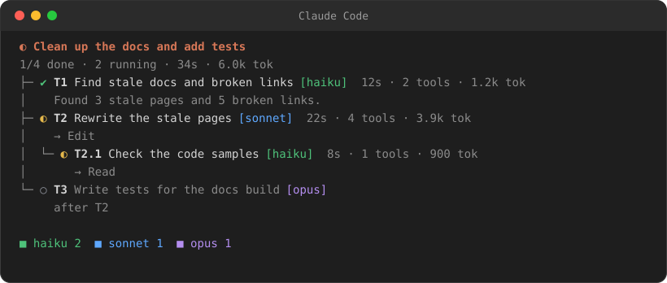
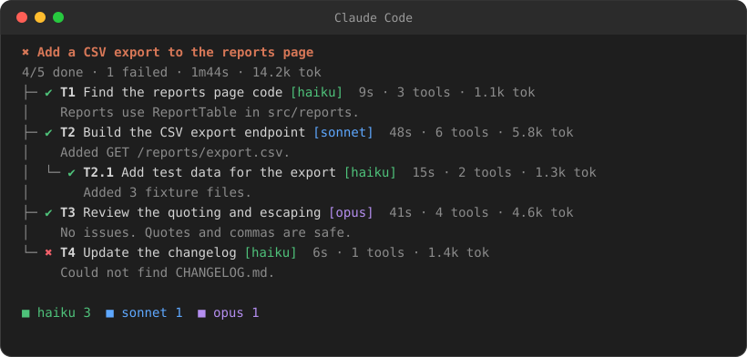

# Claude Orchestrator

A Claude Code plugin. It splits a task into subtasks and gives each subtask to a subagent on a fitting model.

[](LICENSE)
[](CHANGELOG.md)
[](https://github.com/TheBestIT/claude-orchestrator)



## Features

- The main Claude instance becomes an orchestrator. It splits the task and delegates the work.
- Each subtask runs on a model tier that fits it: `haiku`, `sonnet` or `opus`.
- The plugin sets the subagent model from the plan. The orchestrator cannot override it.
- A live pane shows the task tree. It shows the status, model, time, tool calls and tokens of each subagent.
- A subagent that another subagent starts shows below its parent.

## Requirements

- Claude Code with plugin support. The author tested version 2.1.306.
- A Claude Code setup that can use the `haiku`, `sonnet` and `opus` models.

## Installation

### A: Install from GitHub

1. Add the marketplace in Claude Code:

   ```
   /plugin marketplace add TheBestIT/claude-orchestrator
   ```

2. Install the plugin:

   ```
   /plugin install orchestrator@claude-orchestrator
   ```

3. Restart Claude Code.

You can also use one step. This command adds the marketplace and installs the plugin:

```
claude plugin install orchestrator --marketplace TheBestIT/claude-orchestrator
```

### B: Use a local clone

1. Clone the repository:

   ```
   git clone https://github.com/TheBestIT/claude-orchestrator.git
   ```

2. Start Claude Code with the plugin folder:

   ```
   claude --plugin-dir <path-to>/claude-orchestrator
   ```

This method loads the plugin for one session only.

### Update

Update the plugin from a terminal:

```
claude plugin update orchestrator@claude-orchestrator
```

Restart Claude Code to apply the update.

### Uninstall

Remove the plugin from a terminal:

```
claude plugin uninstall orchestrator@claude-orchestrator
```

To remove the marketplace also, run `claude plugin marketplace remove claude-orchestrator`.

## Quick start

1. Start Claude Code in your project.
2. Type a task with the command:

   ```
   /orchestrate Clean up the docs and add tests for the parser
   ```

3. Watch the pane. The orchestrator makes a plan and starts the subagents.
4. Read the short summary that the orchestrator gives at the end.

To use orchestrator mode for each task in a session, type `/orchestrate on`.

## How it works

1. The orchestrator reads the project and calls the `plan` tool. The plan has the goal and a tree of subtasks. Each subtask has an id, a title, a model tier and a reason.
2. The orchestrator starts a subagent for each subtask with the Agent tool. The description starts with the id, for example `[T2] Add parser tests`.
3. The plugin reads the id and sets the subagent model from the plan. The plan model is used, also when the orchestrator sends a different model.
4. The plugin records each subagent: status, model, time, tool calls, tokens and the first line of the answer.

## Model tiers

| Tier | Use it for |
| --- | --- |
| `haiku` | Typo fixes, renames, formatting, simple searches, boilerplate |
| `sonnet` | Features with a clear spec, tests, normal bugs, docs |
| `opus` | Design, difficult bugs, security, performance, unclear requirements |

The orchestrator picks the cheapest model that can do the subtask well.

## The pane

The pane shows the task tree while the work runs:

```
◐ Clean up the docs and add tests
1/4 done · 2 running · 41s · 9.8k tok
├─ ✔ T1 Fix typos in README [haiku]  12s · 2 tools · 1.2k tok
│    Fixed 3 typos in README.md.
├─ ◐ T2 Write parser tests [sonnet]  29s · 5 tools
│    → Edit
│  └─ ◐ T2.1 Find parser files [haiku]  4s
│       → Grep
└─ ○ T3 Redesign the error model [opus]
     after T2

■ haiku 2  ■ sonnet 1  ■ opus 1
```

Symbols: `○` planned, `◐` running, `✔` done, `✖` failed.

When the run ends, the pane shows the result of each subtask:



## Commands

| Command | What it does |
| --- | --- |
| `/orchestrate <task>` | Opens the pane and starts the task in orchestrator mode |
| `/orchestrate on` | Makes each task in this session use orchestrator mode |
| `/orchestrate off` | Stops orchestrator mode |
| `/orchestrate tree` | Opens the task tree pane |
| `/orchestrate clear` | Removes the task tree |

## Examples

See [examples/README.md](examples/README.md) for example tasks and their plans.

## Development

Run these commands in the repository root.

Validate the plugin:

```
claude plugin validate .
```

Run the tests:

```
claude plugin test .
```

The mod code is in `hooks/register.tsx`. The tests are in `tests/orchestrator.test.tsx`.

## Limits

- In `claude -p`, `/orchestrate <task>` does not start the task, because the run stops after the command. Use `/orchestrate on` and then send the task, for example with `--input-format stream-json`.
- A cheap model can say that it did a step when it did not. The orchestrator prompt tells the main model to check the evidence.
- The pane shows in the interactive terminal. It does not show in `claude -p`.

## Contributing

Read [CONTRIBUTING.md](CONTRIBUTING.md) before you open a pull request. See [CHANGELOG.md](CHANGELOG.md) for the change history.

## License

This project uses the [MIT License](LICENSE).
